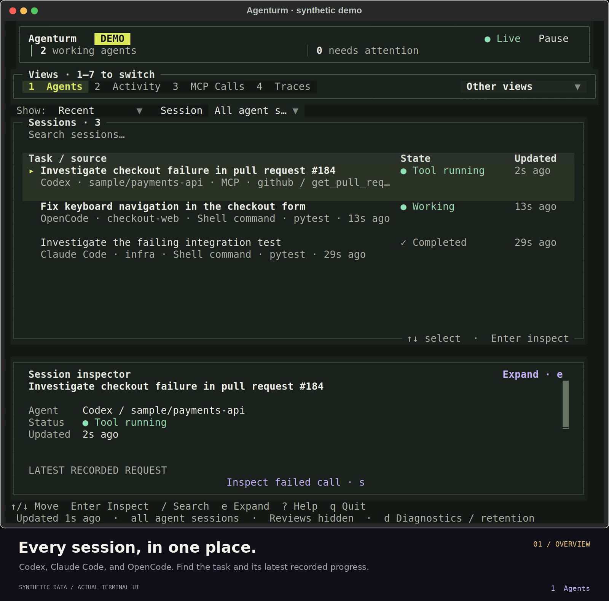

<picture>
  <source media="(max-width: 600px)" srcset="https://raw.githubusercontent.com/abhishekash/abhishekash/main/assets/profile-hero-mobile.svg">
  
</picture>

<p align="center">
  <a href="https://www.agenturm.dev/"><b>Watch your agents</b></a> &nbsp; · &nbsp;
  <a href="https://github.com/abhishekash/spanhound"><b>Inspect a failure</b></a> &nbsp; · &nbsp;
  <a href="docs/engineering-notes.md"><b>Engineering notes</b></a>
</p>

I'm **Abhishek**, a Senior Staff Engineer in **Berlin**. I build open-source tools that make complex systems easier to understand and operate. My current focus is **AI agent observability**: see what ran, find what failed, and turn that failure into a repeatable check.

##  [Agenturm](https://www.agenturm.dev/)

**Know what your agents are doing.**

[](https://www.agenturm.dev/#terminal) [](https://github.com/abhishekash/agenturm/blob/main/docs/privacy.md) [](https://github.com/abhishekash/agenturm/actions/workflows/ci.yml)

Local observability for **Codex, Claude Code, OpenCode, and Pi**, from one terminal. See their recorded progress, inspect tool calls, and find what needs your attention. Connect other supported tools through **OpenTelemetry**.

<a href="assets/agenturm-demo.mp4">
  
</a>

<p align="center"><sub>Actual terminal UI · synthetic records · <a href="https://www.agenturm.dev/#live-ui">Try the interactive demo</a> · <a href="assets/agenturm-demo.mp4">Watch the full 29-second video</a></sub></p>

- **Find the session.** Bring recent supported local records together automatically, without restarting your agents.
- **Inspect the call.** Read prompts, commands, MCP arguments, responses, and failures.
- **Follow the trace.** Put a tool call back in the context of its run.

Keyboard-first, with seven views and five terminal themes: **Observation** (default), **Current (Alpine Ember)**, **Bright**, **Dark**, and **Solarized**. Replies and approvals stay in the agent's own terminal.

### Start locally

Requires **Python 3.11+**, Git, and [uv](https://docs.astral.sh/uv/getting-started/installation/). On macOS or Linux:

```bash
curl -fsSL https://www.agenturm.dev/install.sh | bash
agenturm
```

[Review the installer](https://www.agenturm.dev/install.sh) before running it. Or run directly from the source repository with uv, including on Windows:

```bash
uvx --from git+https://github.com/abhishekash/agenturm agenturm
```

**Local by default. No account required.** Supported records are read on your machine and stored in local SQLite. Local monitoring and recorded-progress summaries need no API key.

Captured messages, commands, and tool results may contain sensitive project information. Optional AI summaries send documented session evidence to your configured provider only when explicitly requested. [Read the capture and privacy boundaries](https://github.com/abhishekash/agenturm/blob/main/docs/privacy.md).

**[Explore Agenturm →](https://www.agenturm.dev/)** &nbsp; [Source](https://github.com/abhishekash/agenturm) &nbsp; · &nbsp; [Setup & docs](https://github.com/abhishekash/agenturm/blob/main/docs/usage.md) &nbsp; · &nbsp; [Integrations](https://github.com/abhishekash/agenturm/blob/main/docs/frameworks.md) &nbsp; · &nbsp; [Report an issue](https://github.com/abhishekash/agenturm/issues/new?template=first_run.yml)

## SpanHound

**Give your MCP client the evidence behind an agent failure.**

[](https://pypi.org/project/spanhound/) [](https://github.com/abhishekash/spanhound/actions/workflows/ci.yml) [](https://registry.modelcontextprotocol.io/v0.1/servers/io.github.abhishekash%2Fspanhound/versions)

Capture supported Python calls, receive local OTLP/HTTP, or inspect saved **JSONL and OTLP JSON traces**. Read-only MCP tools expose recorded failures, approval decisions, token usage, and run comparisons.

<a href="https://github.com/abhishekash/spanhound/blob/main/docs/shell-boundary-story.md">
  <picture>
  <source media="(max-width: 600px)" srcset="https://raw.githubusercontent.com/abhishekash/abhishekash/main/assets/spanhound-demo-mobile.svg">
  
  </picture>
</a>

```bash
uvx spanhound demo
```

Try the bundled scripted regression without an API key. To investigate your own agent, [capture or load its traces](https://github.com/abhishekash/spanhound#capture-your-own-traces).

**[Explore the repo →](https://github.com/abhishekash/spanhound)** &nbsp; [Connect an MCP client](https://github.com/abhishekash/spanhound#client-configuration) &nbsp; · &nbsp; [Watch the demo](https://github.com/abhishekash/spanhound/blob/main/docs/media/shell-root-escape-demo.mp4)

<sub>SpanHound also needs Python 3.11+ and <a href="https://docs.astral.sh/uv/getting-started/installation/">uv</a>. Both projects use the MIT license.</sub>

## From a failed run to a regression test

The tools grew out of a concrete bug: an agent runtime blocked a shell command that escaped its workspace, but its trace omitted the returned error. The fix connected **the runtime, the trace inspector, and a regression test**. [Read the case study →](https://github.com/abhishekash/agent-evals#debugging-story-a-shell-escape-becomes-a-traceable-regression)

| Project | What you can use it for |
| :--- | :--- |
| **[agent-harness](https://github.com/abhishekash/agent-harness)** | Explore a reference runtime with approvals, bounded tool execution, and OpenTelemetry traces. |
| **[agent-evals](https://github.com/abhishekash/agent-evals)** | Run task fixtures, score outcomes and traces, and check regressions. |
| **[agent-skills](https://github.com/abhishekash/agent-skills)** | Reuse workflows for trace debugging, MCP development, and evaluation. |

I document the [design decisions, experiment results, and current limits](docs/engineering-notes.md) alongside the code.

---

**Building with agents?** Try a tool on a real workflow and [tell me what was missing](https://github.com/abhishekash/agenturm/issues/new?template=first_run.yml). If it helps, star the repository so you can find it again and follow the project for updates.
