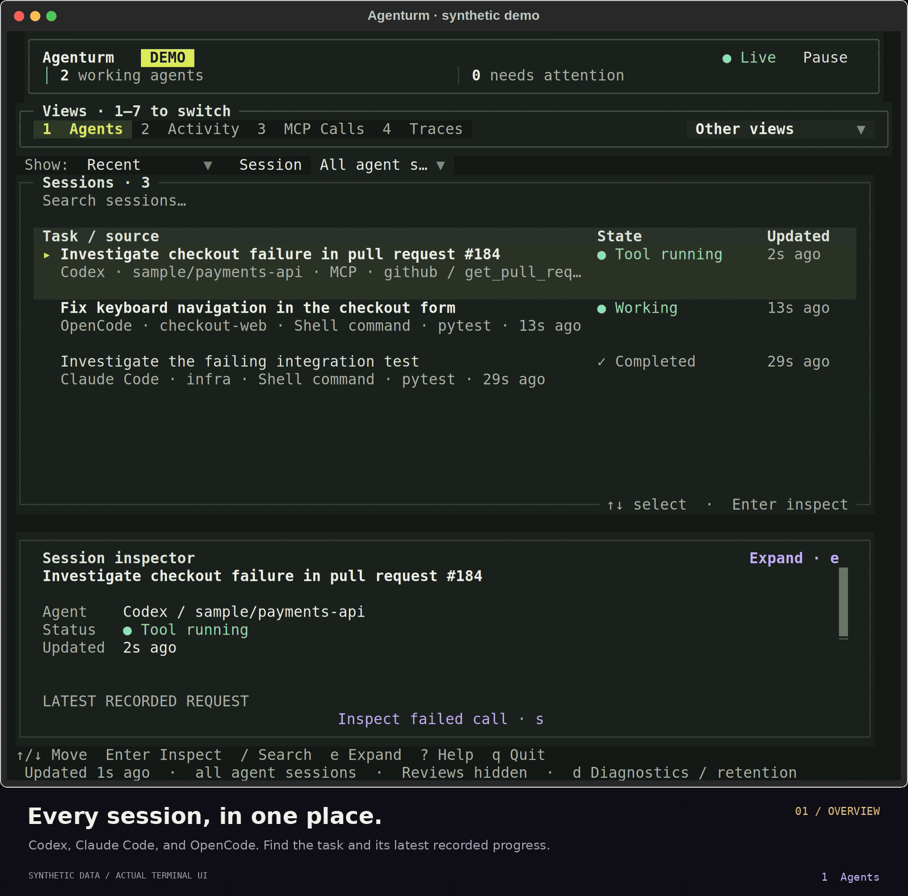

# Abhishek Ash

**Senior Staff Engineer at HelloFresh · Berlin**

I build distributed systems and tools that make AI agents easier to understand. At HelloFresh, I work on distributed systems and agentic architecture, with a background in event-driven platforms, APIs, and reliability. My independent open-source projects explore how to inspect what ran, understand what failed, and turn a failure into a repeatable check.

[Website](https://abhishekash.github.io/) · [Writing](https://abhishekash.github.io/blog/) · [Professional background & contact](https://www.linkedin.com/in/abhishekash/) · [RSS](https://abhishekash.github.io/blog/feed.xml)

## Selected writing

- **[Agents Don't Fail Loudly](https://abhishekash.github.io/blog/agents-dont-fail-loudly.html)** — An agent calls a refund API. The request times out. Did the refund happen? On unknown outcomes, idempotency, and recovery. *Essay, 30 October 2026.*
- **[On quality metrics and systems thinking](https://www.linkedin.com/posts/abhishekash_the-fallacy-of-sacrificing-quality-to-build-activity-7162430428891582464-0UeC)** — Goodhart’s law and the limits of measuring quality through a metric wall. *LinkedIn note.*
- **[On building hyper-personal apps](https://www.linkedin.com/posts/abhishekash_with-the-commoditization-of-ai-models-building-activity-7477636246845120513-cbI8)** — What changes when you build software for one person. *LinkedIn note.*
- **[Engineering notes](docs/engineering-notes.md)** — Design decisions, experiments, and the limits of the evidence behind the agent tools.

## Open source

### [Agenturm](https://www.agenturm.dev/)

Local observability for **Codex, Claude Code, OpenCode, and Pi**, from one terminal. Find sessions, inspect recorded progress and tool calls, and follow traces. Local monitoring needs no account or API key; replies and approvals stay in the agent’s own terminal.

```sh
uvx agenturm
```

[Interactive demo](https://www.agenturm.dev/#demo) · [Source](https://github.com/abhishekash/agenturm) · [Setup](https://github.com/abhishekash/agenturm/blob/main/docs/usage.md) · [Capture & privacy boundaries](https://github.com/abhishekash/agenturm/blob/main/docs/privacy.md)

<details>
<summary>Watch the terminal walkthrough — synthetic example records</summary>

<a href="https://github.com/abhishekash/abhishekash/blob/main/assets/agenturm-demo.mp4">
  
</a>

Actual terminal UI, using synthetic records. [Watch the full video](https://github.com/abhishekash/abhishekash/blob/main/assets/agenturm-demo.mp4).

</details>

### [SpanHound](https://github.com/abhishekash/spanhound)

Read-only MCP tools for inspecting recorded agent failures, approvals, token usage, and run comparisons. Capture supported Python calls, receive local OTLP/HTTP, or load saved traces.

```sh
uvx spanhound demo
```

[Reproducible debugging story](https://github.com/abhishekash/spanhound/blob/main/docs/shell-boundary-story.md) · [48-second walkthrough](https://github.com/abhishekash/spanhound/blob/main/docs/media/shell-root-escape-demo.mp4) · [Connect an MCP client](https://github.com/abhishekash/spanhound#client-configuration)

Both commands require **Python 3.11+** and [uv](https://docs.astral.sh/uv/getting-started/installation/). The SpanHound demo is a bundled scripted regression and needs no API key.

### Runtime, evaluation, and workflows

| Project | What it does | Start here |
| :--- | :--- | :--- |
| [agent-harness](https://github.com/abhishekash/agent-harness) | Reference runtime with approval gates, bounded execution, MCP tools, and OpenTelemetry traces. | [Architecture decisions](https://github.com/abhishekash/agent-harness/blob/main/docs/architecture-postmortem.md) |
| [agent-evals](https://github.com/abhishekash/agent-evals) | Task fixtures and trace-backed scorers for routing, approvals, budgets, and side effects. | [Evaluation report](https://github.com/abhishekash/agent-evals/blob/main/results/RESULTS.md) |
| [agent-skills](https://github.com/abhishekash/agent-skills) | Reusable workflows for trace debugging, MCP development, and evaluation. | [Browse the skills](https://github.com/abhishekash/agent-skills/tree/main/skills) |

The tools connect through a concrete bug: the harness blocked a command that escaped its workspace, but the trace omitted the returned error. Recording that diagnostic made the failure inspectable in SpanHound and testable in agent-evals. [Read the regression walkthrough](https://github.com/abhishekash/agent-evals#debugging-story-a-shell-escape-becomes-a-traceable-regression).

The published **8/8 report is a scripted runtime baseline**, not a live-model reliability score. [Engineering notes](docs/engineering-notes.md) record the experiments and their limits.

---

Outside work: small apps for my family and a soft spot for the Himalayas. More [about me](https://abhishekash.github.io/#about), or [say hello on LinkedIn](https://www.linkedin.com/in/abhishekash/).
