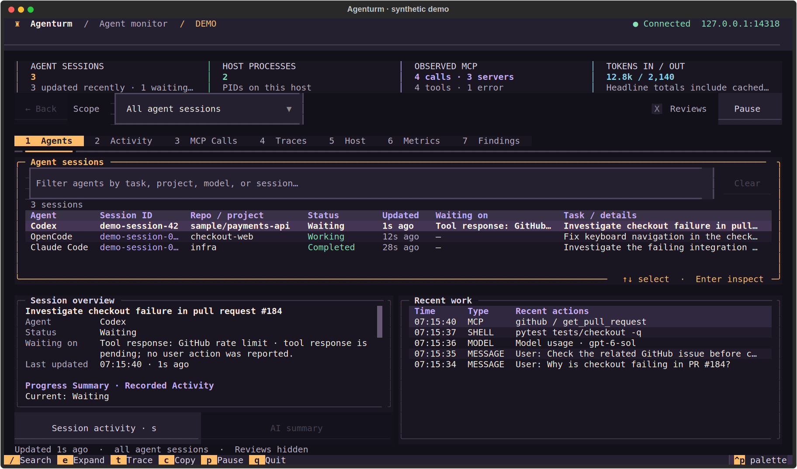

<picture>
  <source media="(max-width: 600px)" srcset="https://raw.githubusercontent.com/abhishekash/abhishekash/main/assets/profile-hero-mobile.svg">
  
</picture>

<p align="center">
  <a href="https://github.com/abhishekash/agenturm"><b>Watch your agents</b></a> &nbsp; · &nbsp;
  <a href="https://github.com/abhishekash/spanhound"><b>Inspect a failure</b></a> &nbsp; · &nbsp;
  <a href="docs/engineering-notes.md"><b>Engineering notes</b></a>
</p>

I'm **Abhishek**, a Senior Staff Engineer in **Berlin**. I build tools that make complex systems easier to understand and operate. My current focus is **AI agent observability**: see what ran, find what failed, and turn that failure into a repeatable check.

##  [Agenturm](https://github.com/abhishekash/agenturm)

**A clear view of every agent.**

[](https://github.com/abhishekash/agenturm) [](https://github.com/abhishekash/agenturm#start) [](https://github.com/abhishekash/agenturm/actions/workflows/ci.yml)

A local terminal monitor for **Codex, Claude Code, OpenCode, and OpenTelemetry agents**. See which sessions are working and what they last did, then inspect their prompts, recorded progress, MCP calls, and linked traces.

<a href="https://github.com/abhishekash/agenturm">
  
</a>

<p align="center"><sub>Actual terminal UI · synthetic example data · <a href="https://github.com/abhishekash/agenturm/blob/main/docs/investigation-video.md">Read the walkthrough</a></sub></p>

```bash
uvx --from git+https://github.com/abhishekash/agenturm agenturm
```

Supported local session records are discovered automatically. Local monitoring and recorded-progress summaries need no account or API key. Other runtimes can send telemetry over OTLP.

A compact tower mark and four focused themes: **Current**, **Bright**, **Dark**, and **Solarized**. Formerly **Agent Observatory**.

**[Explore the repo →](https://github.com/abhishekash/agenturm)** &nbsp; [Setup & docs](https://github.com/abhishekash/agenturm#start) &nbsp; · &nbsp; [Report an issue](https://github.com/abhishekash/agenturm/issues/new?template=first_run.yml)

## SpanHound

**Give your MCP client the evidence behind an agent failure.**

[](https://pypi.org/project/spanhound/) [](https://github.com/abhishekash/spanhound/actions/workflows/ci.yml) [](https://registry.modelcontextprotocol.io/v0.1/servers/io.github.abhishekash%2Fspanhound/versions)

Capture supported Python calls, receive local OTLP/HTTP, or inspect saved **JSONL and OTLP JSON traces**. Read-only MCP tools expose recorded failures, approval decisions, token usage, and run comparisons.

<a href="https://github.com/abhishekash/spanhound/blob/main/docs/shell-boundary-story.md">
  <picture>
  <source media="(max-width: 600px)" srcset="https://raw.githubusercontent.com/abhishekash/abhishekash/main/assets/spanhound-demo-mobile.svg">
  
  </picture>
</a>

```bash
uvx spanhound demo
```

Try the bundled scripted regression without an API key. To investigate your own agent, [capture or load its traces](https://github.com/abhishekash/spanhound#capture-your-own-traces).

**[Explore the repo →](https://github.com/abhishekash/spanhound)** &nbsp; [Connect an MCP client](https://github.com/abhishekash/spanhound#client-configuration) &nbsp; · &nbsp; [Watch the demo](https://github.com/abhishekash/spanhound/blob/main/docs/media/shell-root-escape-demo.mp4)

<sub>Both commands need Python 3.11+ and <a href="https://docs.astral.sh/uv/getting-started/installation/">uv</a>. Agenturm also needs Git. Both projects use the MIT license.</sub>

## From a failed run to a regression test

The tools grew out of a concrete bug: an agent runtime blocked a shell command that escaped its workspace, but its trace omitted the returned error. The fix connected **the runtime, the trace inspector, and a regression test**. [Read the case study →](https://github.com/abhishekash/agent-evals#debugging-story-a-shell-escape-becomes-a-traceable-regression)

| Project | What you can use it for |
| :--- | :--- |
| **[agent-harness](https://github.com/abhishekash/agent-harness)** | Explore a reference runtime with approvals, bounded tool execution, and OpenTelemetry traces. |
| **[agent-evals](https://github.com/abhishekash/agent-evals)** | Run task fixtures, score outcomes and traces, and check regressions. |
| **[agent-skills](https://github.com/abhishekash/agent-skills)** | Reuse workflows for trace debugging, MCP development, and evaluation. |

I document the [design decisions, experiment results, and current limits](docs/engineering-notes.md) alongside the code.

---

**Building with agents?** Try a tool on a real workflow and [tell me what was missing](https://github.com/abhishekash/agenturm/issues/new?template=first_run.yml). If it helps, star the repository so you can find it again and follow the project for updates.
